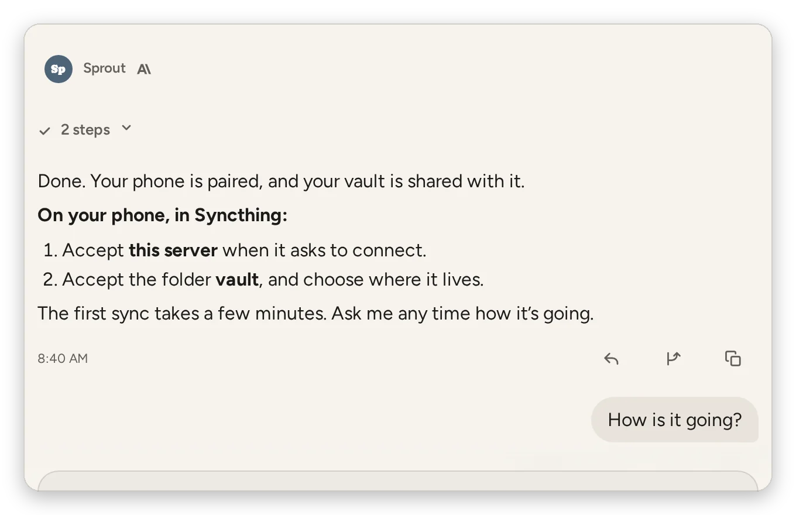
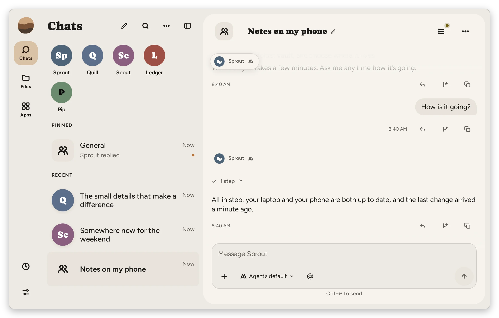

# Syncthing

<!-- loam:hero -->
**Your notes on your own phone and laptop, kept in sync with no cloud in between.**
<!-- /loam:hero -->

A plugin for [Loam](https://github.com/loamhq/loam). Your Loam vault syncs
with your own devices over [Syncthing](https://syncthing.net), and your agents
can pair a new device for you and tell you whether syncing is working.

<!-- loam:gallery -->

*Ask an agent to pair your phone; it tells you the two taps left.*


*Ask how syncing is going, any time.*
<!-- /loam:gallery -->

## What you can do

- **Pair a device by asking.** Give an agent your phone's or laptop's
  Syncthing ID; it adds the device here and shares your vault with it.
- **Know it's working.** Ask how syncing is going, any time.
- **No account, no cloud.** Syncthing is peer to peer: your notes go only
  between your own devices.

## How to use it

1. Get it from **Settings › Market › Syncthing**.
2. Make sure Syncthing runs on your Loam's server and on your device (ask an
   agent if it isn't running on the server; it will tell you how).
3. On your device, find its ID (Actions › Show ID), and tell an agent:
   "share my vault with my phone, its ID is …". Then accept this machine and
   the folder it offers on the device.

## What you need, and what leaves your server

Syncthing on the machine Loam is on (as your own user) and on each device you
want the vault on. No key and no account. Your vault goes only to the devices
you paired, both ways, conversations and your agents' shared memory included.

---

## Technical details

### What it touches

- **Syncthing's own control address on this machine** (127.0.0.1), to read
  and change which devices share your vault. Nothing else on the network.
- **Your vault, both ways**: what a paired device changes arrives in the
  vault, threads and agents' memory included, and what changes here goes out.
- **Syncthing's transfer port**, which it declares so Loam's checks expect it.
- **A tool for your agents**, so they can pair a device and say how syncing
  is going.

When it pairs a device, the vault becomes a Syncthing folder (with `.git`
kept out of it) if it is not one yet. To start Syncthing on the server:
`sudo apt install syncthing`, then
`systemctl --user enable --now syncthing.service`.

### Install from a link

In Settings › Plugins, with its link:

```
https://github.com/michaelhejazi/loam-syncthing/tree/v1.0.2
```

### For builders

[PLUGIN.md](PLUGIN.md) is its manifest. It needs only Python 3.11's standard
library: `tools/syncthing_mcp.py` is the agents' tool (MCP over stdio), and
`tools/syncthing_core.py` talks to Syncthing's REST API on loopback with the
API key from Syncthing's `config.xml`. `python3 tests/test_syncthing.py` runs
it against a fake Syncthing, with no network. The pictures are from Loam's
demo world (`app/tools/capture-plugin-shots.mjs`).

## Made by

Michael Hejazi. Under the AGPL-3.0 ([LICENSE](LICENSE)), as Loam is.
